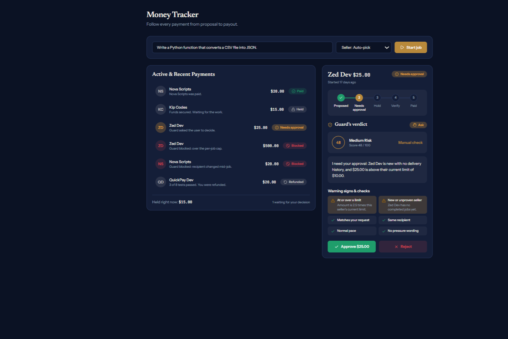
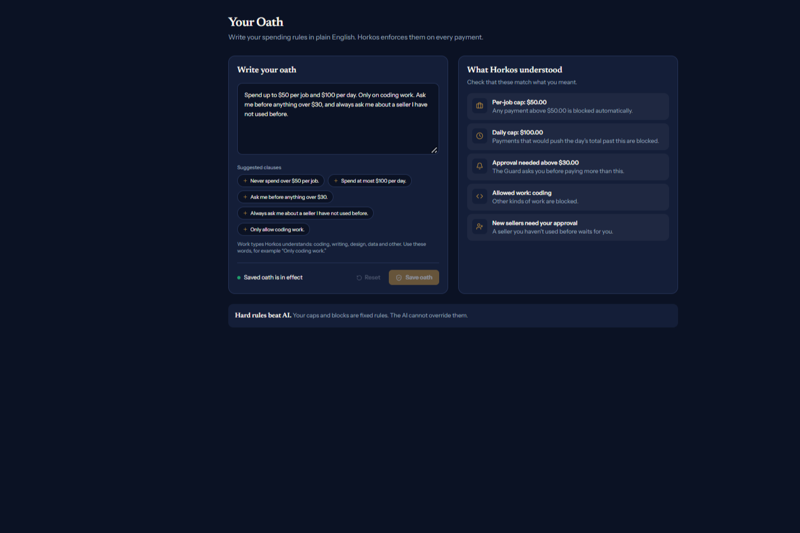
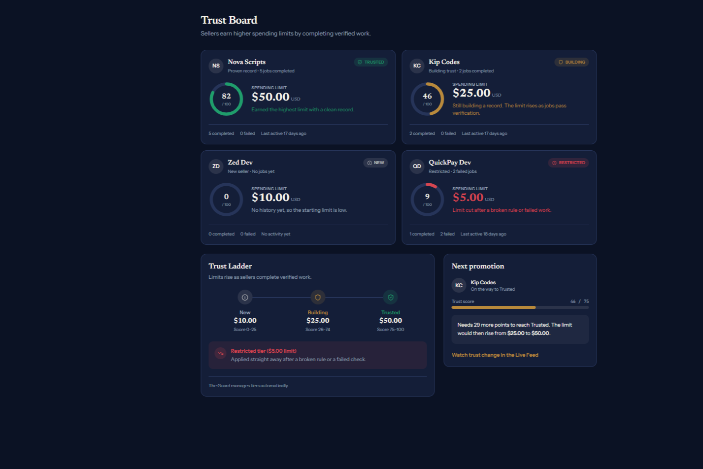
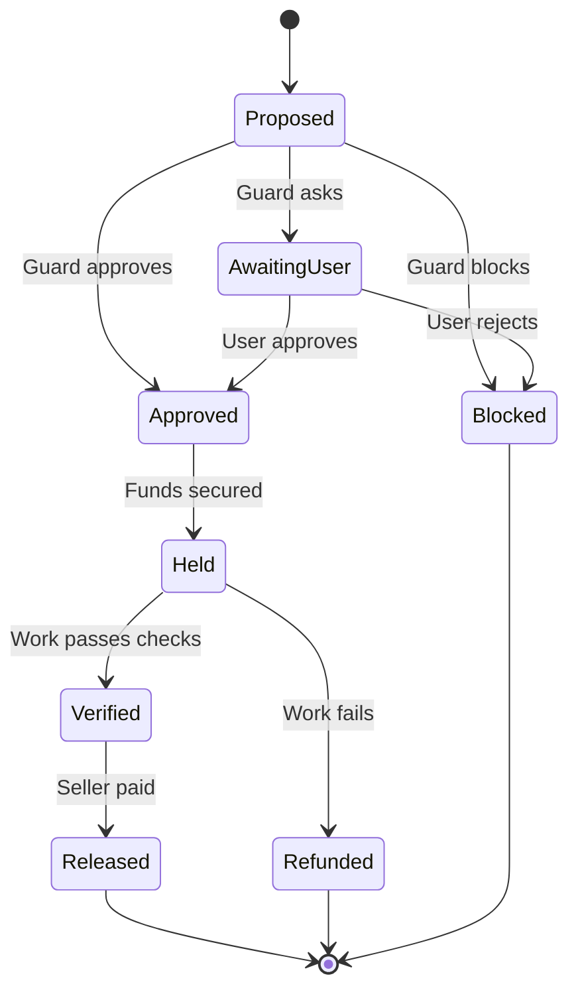
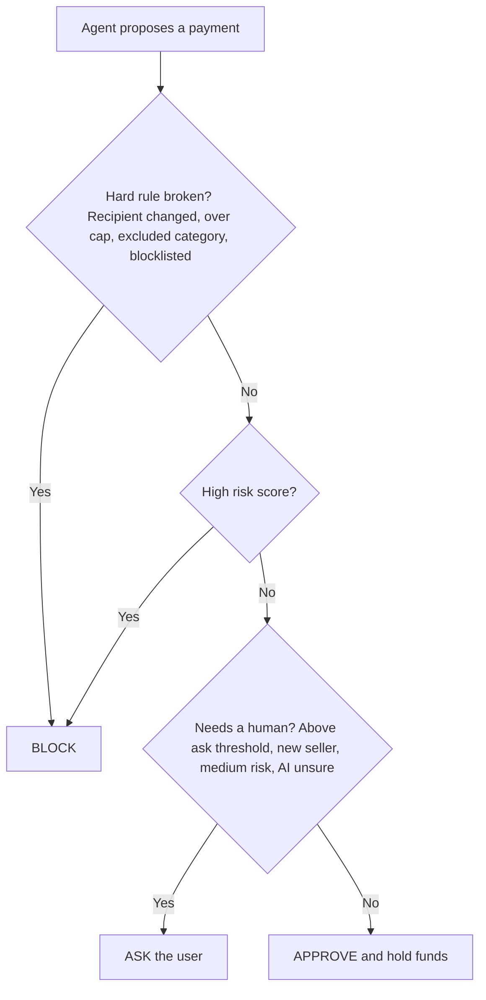
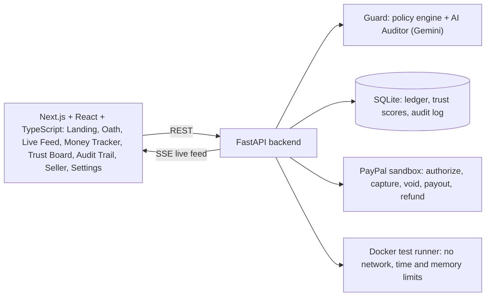

# Horkos

**An AI guard that enforces your spending rules, holds payments until work is proven, and gives more freedom to sellers who earn trust.**


**Demo video:** TODO add the YouTube link here  
**Source code:** this repository (MIT license)  
**Live demo:** none. Run it locally in about 10 minutes with the steps in [Getting started](#getting-started).






> In Greek mythology, *Horkos* is the spirit of oaths, who punishes anyone who breaks a promise. Horkos the app does the same job for AI agents that spend money.

---

## Table of contents

1. [The problem](#the-problem)
2. [What Horkos does](#what-horkos-does)
3. [How it works](#how-it-works)
4. [The Guard: how decisions are made](#the-guard-how-decisions-are-made)
5. [Earned autonomy](#earned-autonomy)
6. [How we use PayPal](#how-we-use-paypal)
7. [How we use AI](#how-we-use-ai)
8. [How we used APIMatic](#how-we-used-apimatic)
9. [Architecture and tech stack](#architecture-and-tech-stack)
10. [Getting started](#getting-started)
11. [Trying the demo](#trying-the-demo)
12. [Testing](#testing)
13. [Project structure](#project-structure)
14. [Safety and limitations](#safety-and-limitations)
15. [Roadmap](#roadmap)
16. [Team](#team)
17. [License](#license)

---

## The problem

AI agents can already shop, hire and pay on our behalf. What is missing is **trust**. Would you let an agent spend your money if it could be tricked into paying the wrong person, paying too much, or paying for work that was never delivered?

Today's options are blunt: a single spending cap, or a human approving every payment. Neither scales, and a numeric cap cannot tell whether a payment actually matches what you asked for.

### Who it is for

- **Developers and companies building agents** that buy services, data and compute on a user's behalf.
- **Marketplaces** where agents hire freelancers or other agents and need payment to follow proof of work.
- **Payment platforms** that want a safe way to let their customers' agents spend.

## What Horkos does

Horkos sits between an AI agent and PayPal. It does four things:

1. **Enforces your rules.** You write your spending rules (your *oath*) in plain English. Horkos turns them into a policy it checks on every payment.
2. **Guards every payment.** A policy engine plus an AI Auditor review each proposed payment and answer **Approve**, **Block** or **Ask**, always with a plain-English reason.
3. **Ties payment to proof.** A payment is simulated by default or authorized in the PayPal sandbox. Automated tests check the delivered code in an isolated Docker container. Passing work is captured and paid to the seller; failing work is refunded (or its authorization is voided).
4. **Lets trust be earned.** New sellers get small limits and need approval. Sellers with a proven record get higher limits and are paid automatically. A failure tightens limits immediately.

**In one line:** agents can already spend money. Horkos makes it safe to let them.

### What makes it different

- **The Guard reads intent, not just numbers.** It compares each payment with what the user actually asked for, which a spending cap cannot do.
- **Hard rules beat AI.** The AI can make a decision more cautious, but it can never override a hard block. This is what makes it hard to talk the system into a bad payment.
- **Payment is tied to proof.** The seller's work is checked by automated tests in an isolated sandbox before any money is released.
- **Autonomy is earned, not granted.** Limits grow with a track record and shrink after a failure.
- **Every decision is explainable.** Each verdict is stored with a plain-English reason in an audit trail.

### What is real today

| Area | Status |
|---|---|
| Oath, Guard, Buyer Agent, Auditor (Gemini), trust scores, audit trail, live feed, login and sign-up | Working in this build |
| Seller code verification in a Docker sandbox | Working (needs Docker running) |
| PayPal sandbox funding: authorize, capture, void, payout, refund | Working when `PAYPAL_FUNDING=sandbox`. **Simulated by default**, so the app runs without PayPal keys |
| AI Verifier for subjective work | Not built. Verification is automated tests only |
| Managed seller blocklist | Not built. Low trust after failed work is enforced |

---

## How it works

A typical job, from Amara's point of view:

1. **Amara writes her rules once.** For example: "Spend up to $50 per job and $100 per day. Only on coding work. Ask me before anything unusual."
2. **Her Buyer Agent proposes a payment.** She asked for a script, and the agent finds a seller and proposes paying $20 if the delivered code passes agreed tests.
3. **The Guard reviews it.** It checks the proposal against her rules, her original request, and the seller's trust score. Result: Approve, Block or Ask.
4. **The money is held.** The payment is held (in PayPal's sandbox when funding is switched on, otherwise in the demo ledger).
5. **The seller delivers.** An authenticated seller submits code, which is run against the agreed tests in an isolated Docker container.
6. **Horkos settles the payment.** Passing tests capture the authorization and pay the seller; failing tests refund the buyer. If the runner cannot reach a verdict, no money moves and the seller can submit again.
7. **Everything is logged.** Every step appears on the live feed and in the audit trail.

### Payment lifecycle



---

## The Guard: how decisions are made

The Guard checks rules in a fixed order. **The first rule that fires decides the outcome.** Hard rules run before the AI gets any say.



| Step | Outcome | Examples |
|---|---|---|
| 1. Hard rules | **Block** (no AI judgment, no exceptions) | Recipient changed mid-job; amount breaks the oath's caps; job category the user excluded; blocklisted seller or trust score below the floor |
| 2. High risk | **Block** | Combined risk score from the soft signals is in the high band |
| 3. Needs a human | **Ask** | Amount above the user's "ask me" threshold; brand-new seller; amount above the seller's current limit; medium risk; the Auditor is unsure or cannot parse the request |
| 4. All clear | **Approve** | Risk is low and the amount fits within the seller's current trust-based limit |

### The six risk signals

1. **Intent mismatch:** the payment does not closely match what the user asked for (judged by the AI).
2. **Recipient unknown or changed:** a hard block if it changes mid-job.
3. **Edge-of-limit amount:** a sudden jump to just under a cap, compared with the seller's usual amounts.
4. **Velocity:** several requests in a row, or retries right after a block.
5. **Unproven seller:** no or low trust score combined with a large request.
6. **Pressure language:** urgency or "skip the review" phrasing in the request.

### Design principles

- **Hard rules beat AI.**
- **Fail safe.** Any error, timeout or uncertainty results in **Ask**, never **Approve**.
- **Every verdict comes with a reason.**

---

## Earned autonomy

Horkos keeps a trust score for every seller. The score decides how much freedom they get.

| Stage | What happens (example values, configurable) |
|---|---|
| New seller | Low limit (for example $10). The user must approve. |
| A few clean deliveries | Trust rises. The limit climbs (for example $25) and approval is automatic. |
| Proven seller | The limit reaches the user's maximum. Payments flow with no human involved. |
| Any failure or red flag | Trust drops sharply. Limits tighten immediately. |

The numerical thresholds are demo defaults that can be tuned; the trust progression stays the same.

---

## How we use PayPal

Horkos only targets the **PayPal sandbox**. Funding is **simulated by default**, so the app can run without PayPal credentials. Set `PAYPAL_FUNDING=sandbox` and provide sandbox app credentials to exercise real sandbox transactions; production PayPal is not supported.

- **Authorize:** The backend creates an Orders v2 order with intent `AUTHORIZE`. The buyer approves it on PayPal, then Horkos authorizes the order and holds the funds.
- **Pass verification:** Horkos captures the authorization and sends a separate payout to the seller using PayPal's Payouts REST API.
- **Fail verification:** Horkos voids an uncaptured authorization or refunds a captured payment.
- **Seller destinations:** The backend seeds the seller profiles and routes each payout to that seller's configured PayPal email. Set `SELLER_PAYPAL_EMAILS` to comma-separated `seller_slug=email` pairs, such as `sel_nova=nova@personal.example.com,sel_kip=kip@personal.example.com`. Leave `PAYPAL_PAYOUT_EMAIL` empty to keep these destinations separate. A non-empty `PAYPAL_PAYOUT_EMAIL` overrides the per-seller email and sends every payout to the same account. The email mappings must refer to PayPal sandbox accounts you have created; Horkos does not provision PayPal accounts.
- **Payout status:** Horkos checks a payout batch up to five times, three seconds apart. Explicit failure states stop settlement. If PayPal has not returned a final status after the polling window, the current demo records the payout as released; verify unresolved batches in the PayPal sandbox dashboard.
- **Not used:** delayed disbursement, a PayPal platform feature that needs partner onboarding.

The app's simulated ledger and PayPal sandbox transactions are for demonstration only. They are not a production escrow or financial service.


## How we use AI

Horkos uses the **Gemini API** for its AI roles. We chose a lite model because the full models were too slow for a live demo.

| Role | What it does |
|---|---|
| **Buyer Agent** | Turns a user's request into a payment proposal, plus acceptance tests and a test file. It returns structured JSON that the backend validates. It can only *propose*; it can never move money itself. |
| **Auditor** | Checks whether the payment buys the kind of work the user asked for, and returns a structured verdict with a plain-English reason. Price is judged by the code's fixed rules, not by the AI. |
| **Verifier** (not implemented) | No AI review for subjective work is currently provided. Verification today is automatic: submitted Python code runs against generated acceptance tests in the Docker sandbox, with no AI involved. |

The AI never touches credentials or money. The backend validates everything the AI returns, and the hard rules cannot be overridden by it.

## How we used APIMatic

We built the PayPal integration with the APIMatic Context Plugin for PayPal inside VS Code, using GitHub Copilot’s agent mode. The plugin gives the coding agent accurate, up-to-date knowledge of PayPal's APIs and SDKs, so the code it writes is based on the real API instead of guesses.

**What it helped with:**

- It provided SDK-specific names and request shapes for creating an Orders v2 order with `AUTHORIZE`, authorizing it, and voiding the authorization.
- Skill-guided work corrected an initial error-handling example: the SDK raises API exceptions for non-2xx responses rather than returning an `is_success()` result to inspect.
- A sandbox run first returned `ORDER_NOT_APPROVED` because the buyer had not approved the order. The error was handled, and a second run completed create, approve, authorize, and void successfully (HTTP 200 for the void).

The application uses the Python Server SDK for PayPal orders and payments; seller payouts use PayPal's Payouts REST API directly. Without the plugin, we would have needed to check the PayPal API and SDK documentation and source manually; we did not measure time saved or run a skills-disabled comparison. The evidence log records the prompts, results, screenshots, and caveats: [docs/apimatic-log.md](docs/apimatic-log.md).

---

## Architecture and tech stack



| Layer | Tools |
|---|---|
| Frontend | Next.js, React, TypeScript, Tailwind CSS, Motion |
| Backend | Python 3.12, FastAPI, Pydantic, Uvicorn |
| Data | SQLite (PostgreSQL not tested), SQLAlchemy 2, Alembic |
| Payments | PayPal Python Server SDK and Payouts REST API (sandbox), internal ledger in integer cents |
| AI | Gemini API |
| Verification | Docker (isolated test runner) |
| Real-time | Server-Sent Events with sse-starlette |
| Auth and security | JWT sessions (PyJWT), Pydantic Settings for secrets |
| Quality | pytest, Ruff, GitHub |
| Deployment (optional) | A Linux VM with Docker (the test runner needs Docker) |

---

## Getting started

### Prerequisites

- Python 3.12 or newer
- Node.js 20.9 or newer
- Docker Desktop or Docker Engine running (required to verify seller submissions)
- A Gemini API key for AI-assisted job proposals and intent checks
- A PayPal developer account and sandbox app only if you want to test real PayPal sandbox funding ([developer.paypal.com](https://developer.paypal.com))

### 1. Configure the backend

From the repository root, copy the example environment file:

```powershell
Copy-Item .env.example .env
```

On macOS or Linux, use `cp .env.example .env`. Set the values you need:

| Variable | Purpose |
|---|---|
| `JWT_SECRET` | Required for signing app login tokens. Use a long random value (at least 32 characters). Generate one with `python -c "import secrets; print(secrets.token_urlsafe(48))"`. |
| `GEMINI_API_KEY` | Google AI Studio API key used by the Buyer Agent and Auditor. |
| `GEMINI_MODEL` | Set to `gemini-3.5-flash-lite` (the application fallback when this variable is unset). |
| `GEMINI_THINKING_LEVEL` | Optional model setting (`low`, `medium`, or `high`) when supported. |
| `DATABASE_URL` | Defaults to `sqlite:///./horkos.db`, stored relative to the backend working directory. |
| `PAYPAL_FUNDING` | Defaults to `simulated`. Set to `sandbox` to use PayPal sandbox transactions. |
| `PAYPAL_CLIENT_ID`, `PAYPAL_CLIENT_SECRET` | Credentials for your PayPal sandbox app; required when funding mode is `sandbox`. |
| `PAYPAL_ENVIRONMENT` | Keep set to `sandbox`; Horkos rejects other environments. |
| `PAYPAL_RETURN_URL`, `PAYPAL_CANCEL_URL` | Optional frontend URLs for the buyer's return from or cancellation of PayPal approval. |
| `SELLER_PAYPAL_EMAILS` | Optional comma-separated seller slug/email pairs for separate sandbox payout destinations. |
| `PAYPAL_PAYOUT_EMAIL` | Optional shared payout recipient. Leave empty to pay each seller's configured email. |
| `FRONTEND_ORIGIN` | Frontend origin allowed by backend CORS; defaults to `http://localhost:3000`. |
| `DEMO_CONTROLS` | Enables demo attack and reset endpoints; defaults to `true`. |

For separate seller payouts, create the seller accounts in PayPal's sandbox and map their recipient emails in `SELLER_PAYPAL_EMAILS`, for example `sel_nova=nova@personal.example.com,sel_kip=kip@personal.example.com`. Keep `PAYPAL_PAYOUT_EMAIL` empty. The backend seeds the Horkos seller profiles and applies these mappings; rerun the seed command after changing the mappings. It does not create PayPal accounts. A non-empty shared payout email overrides the per-seller destinations.

`PAYPAL_FUNDING=simulated` is the default and does not call PayPal. In this mode, PayPal credentials and seller sandbox accounts are not needed. Never commit `.env`; it is ignored by Git.

### 2. Install and start the backend

From the repository root, run:

```powershell
cd backend
python -m venv .venv
.\.venv\Scripts\Activate.ps1
python -m pip install -r requirements.txt
alembic upgrade head
python -m app.scripts.seed
uvicorn app.main:app --reload --port 8000
```

For macOS or Linux, activate the virtual environment with `source .venv/bin/activate`. The seed command is safe to rerun and creates the demo buyer, seller profiles and seller logins. The API is at `http://localhost:8000`, health check at `/health`, and interactive API docs at `/docs`.

### 3. Install and start the frontend

In a second terminal, from the repository root:

```powershell
cd frontend
Copy-Item .env.example .env.local
```

Set `NEXT_PUBLIC_USE_MOCKS=false` in `frontend/.env.local` to connect the screens to the backend. The example defaults to mocks; if this setting is missing or `true`, the app uses built-in sample data. Keep `NEXT_PUBLIC_API_URL=http://localhost:8000` for local development.

```powershell
npm install
npm run dev
```

Open `http://localhost:3000`. If you use another frontend origin, update `FRONTEND_ORIGIN` in the root `.env` and restart the backend.

### 4. Prepare seller verification

Keep Docker running, and pull the test image once before the first submission:

```powershell
docker pull python:3.12-slim
```

Horkos runs the seller's code and acceptance tests in a restricted container built from that image; no custom image build is required. Pulling it first means the first submission is not slowed down by the download.

### Quick check

- `http://localhost:3000` shows the landing page, and `http://localhost:3000/login` loads the sign-in screen.
- `http://localhost:8000/health` returns `{"status":"ok", ...}`.
- `http://localhost:8000/docs` shows the live API routes.
- Log in with the demo buyer and confirm the Oath, Money Tracker, Trust Board, Live Feed and Audit Trail load from the backend.

---

## Trying the demo

The seed script creates Horkos app logins. They are separate from PayPal sandbox credentials:

| App role | Email | Password |
|---|---|---|
| Buyer | `amara@example.com` | `demo-password` |
| Seller (Nova Scripts) | `nova@example.com` | `demo-password` |
| Seller (Kip Codes) | `kip@example.com` | `demo-password` |
| Seller (Zed Dev) | `zed@example.com` | `demo-password` |
| Seller (QuickPay Dev) | `quick@example.com` | `demo-password` |

These are demo-only credentials. You can also create your own buyer or seller account at `/signup` (sellers need a PayPal sandbox email). In PayPal sandbox mode, use a buyer sandbox account to approve the order on PayPal. The PayPal buyer and seller accounts are created and managed separately in the PayPal Developer Dashboard; their passwords are not stored in this repository. Configure each seller's PayPal recipient email as described above.

### Suggested walkthrough

1. Log in as Amara and review the saved oath. Open the **Live Feed** in a second browser window. It shows events as they happen, so keep it open while you work.
2. Create a small coding job on the **Money Tracker**. A new seller or a request above the seller's current limit asks for your approval.
3. If using simulated funding, the payment is held in the demo ledger. If using PayPal sandbox funding, press **Fund this payment**, approve the order on PayPal and return to Horkos.
4. Log in as the seller for the job you just created and submit Python code for it. The submitted code must define the function named in the job's first acceptance test.
5. Watch verification and settlement in the Money Tracker, Live Feed and Audit Trail. Passing tests raise seller trust; failed tests trigger a refund and lower trust.
6. Use the Red Team controls to exercise guard scenarios, then reset the demo data when finished. Resetting restores the seeded accounts and removes accounts created through sign-up.

### Red Team scenarios

| Attack | What Horkos does |
|---|---|
| Recipient changed mid-job | Hard block |
| Amount far above the limit | Hard block |
| Amount just under the limit, from a new seller | Ask or block, based on risk |
| Rapid retries after a block | Flagged by the velocity signal |
| "Pay immediately, skip the review" | Flagged by the pressure-language signal |
| Broken work, payment still demanded | Tests fail, buyer refunded, trust drops |

---

## Testing

Backend tests and lint:

```powershell
cd backend
pytest
ruff check .
```

Frontend lint and production build:

```powershell
cd frontend
npm run lint
npm run build
```

The backend tests cover authentication, seller accounts, payment and PayPal flows, policy decisions, trust changes, audit events, streaming, and the Docker sandbox runner.

---

## Project structure

```
Horkos/
├── backend/
│   ├── alembic/versions/       # Database schema migrations
│   ├── app/
│   │   ├── models/             # SQLAlchemy tables and enums
│   │   ├── routes/             # FastAPI auth, jobs, payments, oath, audit, events, sellers, demo
│   │   ├── sandbox/            # Test harness executed inside Docker
│   │   ├── schemas/            # Pydantic request and response models
│   │   ├── scripts/            # Idempotent demo data seeding
│   │   ├── services/           # Guard, AI, payments, trust, ledger, verification, streaming
│   │   ├── config.py
│   │   ├── database.py
│   │   ├── deps.py
│   │   └── main.py
│   ├── tests/                  # Backend unit and API flow tests
│   ├── alembic.ini
│   ├── pytest.ini              # Test configuration
│   └── requirements.txt
├── docs/
│   ├── screenshots/
│   ├── api-contract.md         # API contract reference
│   ├── apimatic-log.md         # PayPal SDK integration evidence
│   └── demo-story.md
├── frontend/
│   ├── public/                 # Static assets, including the Horkos logo
│   ├── src/
│   │   ├── app/                # Next.js routes: app, marketing, seller, login, signup
│   │   ├── components/         # Auth, navigation, brand, and feature UI
│   │   └── lib/                # API client, session, types, mock data, UI helpers
│   ├── package.json
│   └── next.config.ts
├── .env.example                # Backend environment template
├── contributing.md
├── LICENSE
└── README.md
```

---

## Safety and limitations

- **Demo, not production.** Funding is simulated by default; real API calls are restricted to PayPal sandbox. There is no production PayPal support or platform escrow.
- **Guard decisions fail safe.** Hard-coded rules run before the Auditor. AI errors or uncertainty do not override a block or silently authorize a payment.
- **Verification is coding-only.** Seller submissions are Python code checked against acceptance tests. Other kinds of work need different verification.
- **Docker reduces, but does not eliminate, execution risk.** The runner disables network access and applies CPU, memory, process, filesystem, privilege and time limits. Review the runner and host configuration before using it with untrusted code outside this demo.
- **Demo values are not production policy.** Trust changes, limits, and risk thresholds are illustrative.
- **No managed blocklist yet.** The hard-rule check supports a blocklisted seller fact, but the app does not yet provide persistent user-managed blocklist storage or controls. Low trust after failed work is enforced.
- **Seller submissions require app authentication.** A seller-role account is restricted to jobs assigned to its seller profile; PayPal sandbox accounts are configured separately for payouts. Buyer accounts are not restricted in the same way in this demo.
- **Payout reconciliation is limited.** After roughly 15 seconds of polling, a payout without a final status is currently recorded as released. Check unresolved batches in PayPal and implement durable status reconciliation before any production use.
- **Demo controls can reset data.** Disable them with `DEMO_CONTROLS=false` outside a local demo.
- **Public sign-up.** Anyone who can reach a running instance can create accounts, so do not expose a demo instance publicly.
- **Local database only.** The app is tested with SQLite. PostgreSQL has not been tested.

## Roadmap

- Add verification methods for work beyond Python coding tasks.
- Add durable PayPal payout status reconciliation and operational recovery.
- Add user-managed blocklists and seller identity controls.
- Seller-side agents that negotiate scope and price, and trust that follows a seller across buyers.
- Review the payment and sandbox-runner architecture before any production deployment.

---

## Team

| Name | Role |
|---|---|
| ABIGAIL GATHONI | Frontend and design |
| LEVIS NGANGA | Backend, payments and AI |

See `contributing.md` for how we work.

## Acknowledgements

Thanks to **PayPal Developer** and **APIMatic** for the hackathon, the webinars and the Context Plugin.

## License

Released under the [MIT License](LICENSE).